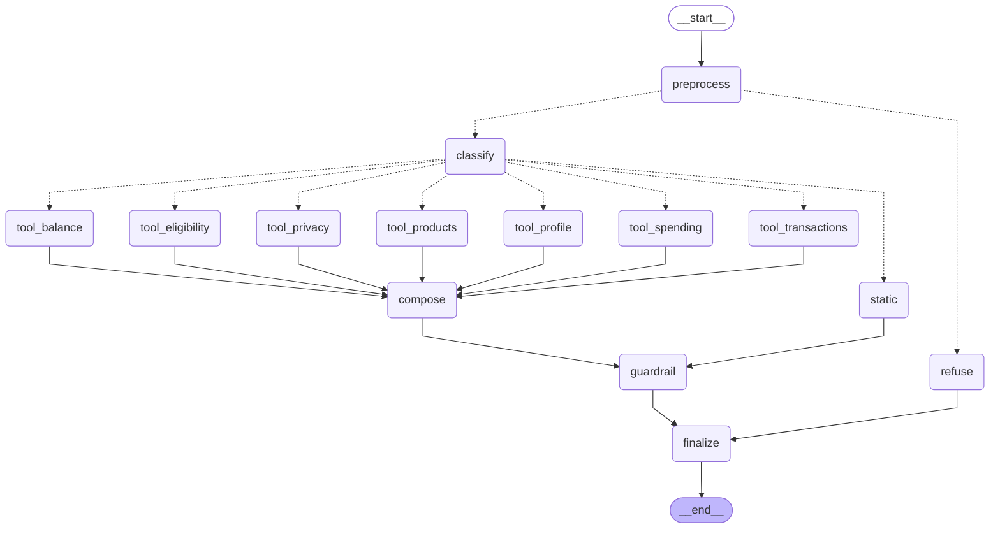

# 🏦 BANKMATE AI — AI-Powered Banking Customer Query Assistant

TCS Technology Day problem statement. Built with **LangGraph** + **Groq** + FastAPI + Streamlit.
All data is **synthetic** (fake). Never use real banking details.

---

## 1. Run it (Windows PowerShell)

```powershell
# 1. Go into the project folder
cd AI_hackathon

# 2. (Optional but recommended) make a virtual environment
python -m venv .venv
.\.venv\Scripts\Activate.ps1

# 3. Install packages
pip install -r requirements.txt

# 4. Paste your Groq key into the file  .env   (GROQ_API_KEY=...)
notepad .env

# 5. Check that your key works (the key is never printed)
python scripts\check_groq.py

# 6. Start everything
python run_all.py
```

Open **http://localhost:8501** and sign in with a demo user.
API docs: http://127.0.0.1:8000/docs

Two terminals instead of `run_all.py`:

```powershell
python -m uvicorn api:app --reload                 # terminal 1 (backend)
python -m streamlit run app.py                     # terminal 2 (frontend)
```

**No key? It still works.** The app falls back to built-in rules. The sidebar shows
"Rules mode" or "Groq LLM ready" so you always know which one is active.

### ⚠️ Important: Groq model names
Groq shut down `llama-3.3-70b-versatile` and `llama-3.1-8b-instant` on **16 Aug 2026**
(source: Groq's deprecations page). Old tutorials still use them and will fail.
This project tries `openai/gpt-oss-120b`, then `openai/gpt-oss-20b`, then `qwen/qwen3.8-27b`.
If all are gone, it asks Groq for the live model list and picks a chat model automatically.
You can force a model with `GROQ_MODEL=` in `.env`.

### Demo users (fictional)

| Username | Password | Consent setting (to show how consent works) |
|---|---|---|
| demo_aarav | Demo@1234 | everything ON |
| demo_priya | Demo@5678 | marketing OFF |
| demo_rohan | Demo@9012 | query logging OFF |
| demo_sneha | Demo@3456 | logging + marketing OFF |
| demo_kiran | Demo@7890 | **AI processing OFF** → nothing goes to Groq |

---

## 2. How it works



(This diagram is generated from the real compiled graph: `GET /chat/graph`.)

| Node | Job |
|---|---|
| `preprocess` | Clean text, **remove PII**, block OTP/PIN requests, other-customer requests, prompt injection |
| `classify` | Groq LLM finds the intent (rules if no LLM). Numbers are read by regex, **never by the LLM** |
| `tool_*` | Python functions fetch data. Customer ID comes from the **login session only** |
| `compose` | Groq LLM writes a friendly answer from masked facts (template if no LLM) |
| `guardrail` | Strips links/HTML, checks every ₹ and % against the facts, adds disclaimers |
| `finalize` | Saves short memory, writes audit log, writes masked query log (only with consent) |

**The LLM cannot:** pick a tool, pick a customer, do maths, or see your name/e-mail/phone.

---

## 3. Problem statement → what is in this project

| Problem statement asks for | Where |
|---|---|
| Understand varied questions, with context | LangGraph + Groq classifier, follow-ups ("and last month?"), Hinglish |
| Balances, transaction history | `tool_balance`, `tool_transactions` (filters: period, category, credit/debit) |
| Loan eligibility | `tool_eligibility` + EMI maths in `services.py` (FOIR 50% rule, illustrative) |
| Interest rates | `data/products.json` (accounts, FD, RD, 4 loans) → `tool_products` |
| Simulated customer query logs (text) | `data/synthetic_query_logs.txt` (600 lines) |
| Product details as structured JSON | `data/products.json` |
| Mock customer data with privacy masking | SQLite, 50 customers; account/e-mail/phone masked **on the server** |
| API endpoints of mock services | `/accounts`, `/transactions`, `/analytics/summary`, `/products`, `/loans/eligibility` |
| Customer profiles with consent flags | `ai_processing`, `query_logging`, `marketing` — enforced in code, editable in the UI |
| Synthetic data generation scripts | `generate_data.py` (+ `database.py` for customers/transactions) |
| Ethical data privacy | See section 5 |
| Preprocessing | `privacy.py` (clean, redact) + `entities.py` (lakh/crore, tenure, period…) |

---

## 4. API endpoints

| Method | Path | Login? |
|---|---|---|
| POST | `/auth/login`, `/auth/logout` | – |
| GET | `/health`, `/chat/graph`, `/products`, `/products/{id}` | no |
| GET | `/customers/{id}`, `/accounts/{id}`, `/transactions/{id}`, `/analytics/summary/{id}` | yes (own ID only) |
| GET/PUT | `/consent/{id}` | yes (own ID only) |
| POST | `/loans/eligibility` | yes (no customer_id field) |
| POST/DELETE | `/chat` | yes (no customer_id field) |

Changed from the old version: the public `/customers/list` is **removed** (it leaked all names),
`/accounts/{id}` now returns a list of accounts, `/loans` became `/products?category=loan`.

---

## 5. Privacy and security (short version)

- PII (card, Aadhaar, PAN, phone, e-mail, UPI, IFSC, OTP/PIN) is removed **before** the LLM, memory and logs.
- Name, e-mail, phone and full account numbers are **never** sent to Groq. Profile/Privacy answers don't use the LLM at all.
- AI consent OFF → zero calls to Groq for that customer.
- Query logging OFF → question text is not stored. Audit log never stores message text.
- LLM answers are checked: any ₹ amount or % not in the real data → replaced by a safe template.
- Password hashing: PBKDF2-SHA256, 600,000 rounds. Lockout and timing are the same for real and fake usernames.
- Rate limit on `/chat` (20/min). Messages max 500 characters.

Full list of what was found and fixed: **AUDIT_REPORT.md**.

---

## 6. Tests

```powershell
python -m pytest tests -q          # 330 tests, ~25 seconds
python scripts\evaluate_intents.py # intent accuracy on the synthetic set
python scripts\e2e_smoke.py        # needs the backend running
```

What the tests cover: privacy/redaction, entity parsing, EMI maths, ledger consistency, auth,
cross-customer access (IDOR), SQL injection, consent, guardrails, multi-turn follow-ups, the UI
(headless), and the **real langchain-groq client over HTTP** against a local mock Groq server
(retired model, bad key, rate limit, timeout, garbage JSON, hallucinated amounts).

**Honest limits of the testing**
- ❗ I could **not** call the real Groq service (no key / no internet in my test machine). The Groq code path
  is tested against a mock that follows Groq's HTTP format. Please run `python scripts\check_groq.py` once with your key.
- The synthetic query set is made from templates, so the rules score (100% clean, ~82% with typos) is optimistic.
  Real users will be harder. That is where the LLM helps.
- Tested with: Python 3.12, langgraph 1.2.14, langchain-groq 1.1.3, groq 0.37.1, fastapi 0.143, streamlit 1.65.

---

## 7. Known limits (prototype)

- Sessions and chat memory are in RAM (lost on restart). Production: Redis/DB, HTTPS, HttpOnly cookies.
- Streamlit keeps the session token in server-side session state, not a cookie.
- Eligibility is a simple illustration (FOIR 50%, highest rate). Not a credit-scoring model.
- Existing loans of a customer are not modelled.
- Old `data/bankmate.db` from the previous version is backed up automatically and rebuilt (schema changed).

---

## 8. Files

```
api.py            FastAPI backend (auth, masked data, consent, /chat)
agent.py          LangGraph workflow
llm.py            Groq adapter (model fallback, circuit breaker)
services.py       Business logic + EMI/eligibility maths
privacy.py        Masking, PII redaction, risk checks
guardrails.py     Output checks
entities.py       Amount/tenure/period/product parsing
nlp.py            Rule-based fallback classifier
responses.py      Safe template answers
database.py       SQLite schema, synthetic customers, auth, logs
products.py       products.json loader
generate_data.py  Synthetic data generator
app.py            Streamlit UI
run_all.py        Start both servers
scripts/          check_groq.py, e2e_smoke.py, evaluate_intents.py
data/             products.json, synthetic_query_logs.txt, query_eval_set.jsonl
tests/            330 tests + mock Groq server
```
